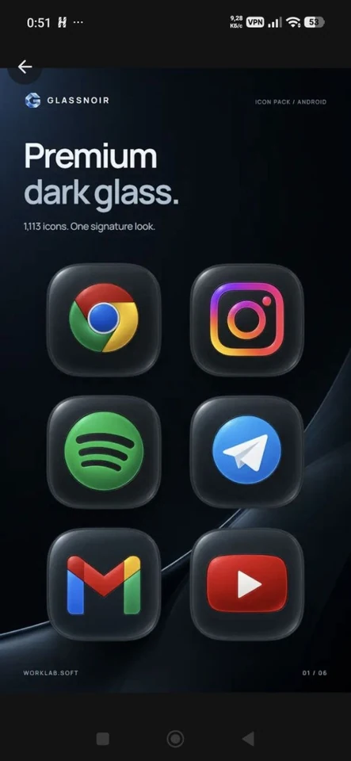
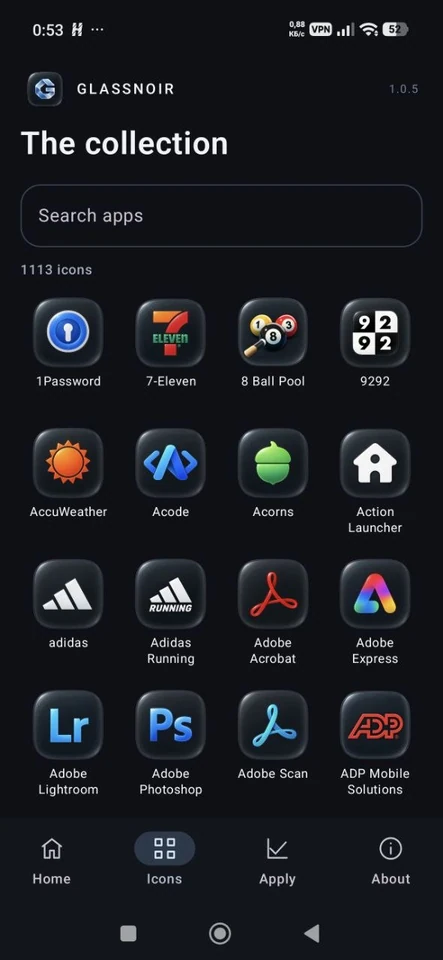

# GlassNoir - набор иконок для Android

**Автор проекта:** [Евгений Толмачев](https://github.com/EvgenyET) · [Страница проекта в портфолио](https://evgeny-dev.pro/project.html?id=GlassNoir)

Набор из 2 105 иконок для Android в стиле тёмного стекла. Поиск по каталогу, просмотр иконок и применение в совместимом лаунчере.

## Мой вклад

Разработал визуальный стиль тёмного стекла и Android-приложение для набора иконок. Сделал каталог, поиск и предварительный просмотр, настроил сопоставление приложений со значками и применение набора через совместимые лаунчеры.

## Интерфейс

| Примеры стеклянных иконок в оформлении GlassNoir | Экран коллекции в Android-приложении |
|:---:|:---:|
|  |  |

## Как это работает

В версии 1.0.9 каталог GlassNoir содержит 2 105 иконок. Пользователь находит приложение через поиск, рассматривает рисунок в увеличенном виде и применяет значок из своего лаунчера. Интерфейс написан на Kotlin и Jetpack Compose.

## Возможности

- Поиск и предварительный просмотр 2 105 иконок.
- Автоматическая подстановка иконок по Android-компонентам и ручной выбор в лаунчере.
- Экспорт графики в WebP 384 × 384 с сохранением прозрачности.

## Технологии

- **Kotlin** - Модель коллекции, поиск, управление состоянием и интеграция с Android.
- **Jetpack Compose** - Нативные экраны, адаптивная компоновка, диалоги и ленивый список иконок.
- **Material 3** - Базовые элементы интерфейса, оформленные в стиле GlassNoir.
- **Android Intents** - Открытие лаунчеров, применение темы в Nova и подготовка письма с запросом значка.
- **Python** - Генерация и проверка каталога, XML-сопоставлений и графических ресурсов.
- **XML и WebP** - Сопоставление приложений и хранение графики набора.

## О проекте

Android-приложение для персонализации рабочего стола. Проект объединяет авторский визуальный стиль иконок, каталог с поиском и интеграцию с совместимыми лаунчерами. Отдельные экраны помогают выбрать значок, применить набор и подготовить запрос на недостающие иконки.

Коммерческий проект. Исходный код закрыт.
